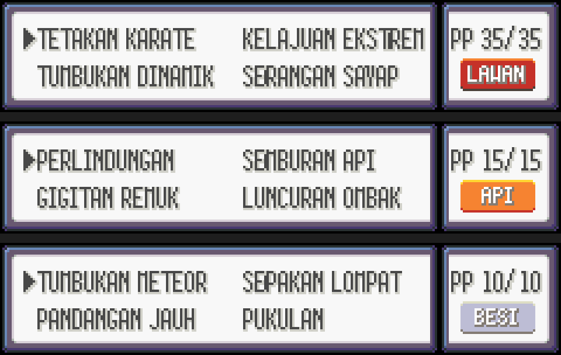

# Log Perubahan

Semua perubahan penting pada terjemahan Bahasa Melayu Pokémon Emerald.

## v0.2.3 (12 November 2026)

### Diubah
- Menu OPTION: PILIHAN → **TETAPAN** (menu utama, menu START dan skrin tetapan).
- Item: BASEMENT KEY → **KUNCI B.TANAH**, ANTIDOTE → **PENAWAR RACUN**,
  PP UP → **NAIK PP**, HP UP → **NAIK HP**.
- Move: **BEDILAN BATU**, **BEDILAN LUMPUR**, **DENYUTAN AIR**, **CIUMAN MANIS**,
  **CIUMAN JELITA**, **PEMECAH BATA**, dan HM06 ROCK SMASH → **PEMECAH BATU**
  (termasuk MAMAT PEMECAH BATU di MAUVILLE).
- Lagi nama move dalam bentuk kata nama: **SERANGAN TIPU**, **SERAPAN GIGA**,
  **SEPAKAN NYALA**, **KETANGKASAN**, **KEMARAHAN**, **KEMURKAAN**, **KEDENGKIAN**,
  **KEWASPADAAN**, **LAGAK**, **IGAUAN**, **RONTAAN**, **SEKSAAN**,
  **GENDANG PERUT**, **LONJAKAN PSIKO**, **MINUMAN SUSU**, **PEMAKAN MIMPI**,
  **PENGERASAN**, **PENGECILAN**, **PENAJAMAN**, **PENYEGARAN**.

## v0.2.2 (12 November 2026)

### Diubah
- GUST: HEMBUSAN → **TIUPAN ANGIN** (seiring ANGIN PISAU, ANGIN BEKU, ANGIN PERAK).

## v0.2.1 (12 November 2026)

### Diubah
- HM01 dan HM03 kembali kepada **POTONG** dan **LUNCUR OMBAK** (dalam v0.2.0
  jadi POTONGAN dan LUNCURAN OMBAK). "Luncur ombak" memang nama sukan dalam
  Bahasa Melayu, manakala "potongan" mudah dibaca sebagai diskaun atau
  sekeping. Untuk HM yang dipakai di luar pertarungan, nama yang jelas lebih
  penting, sama seperti TERBANG dan SELAM. Dialog berkaitan turut dikemas kini.
- Move gelombang tenaga guna "GELOMBANG" (bukan "OMBAK", yang bermaksud ombak
  laut): SHOCK WAVE → **GELOMBANG KEJUT**, THUNDER WAVE → **GELOMBANG PETIR**,
  PSYWAVE → **GELOMBANG PSIKO**, HEAT WAVE → **GELOMBANG HABA**.
- Move tarian guna kata nama "TARIAN": **TARIAN PEDANG**, **TARIAN KELOPAK**,
  **TARIAN HUJAN**, **TARIAN BULU**, **TARIAN HUYUNG**, **TARIAN NAGA**.
- **BERRY → BERI**, ikut susunan Melayu: ORAN BERRY → **BERI ORAN**, CHERI BERRY
  → **BERI CHERI**, dan seterusnya. Nama sistem pun ikut: HANCUR BERI, PENGISAR
  BERI, PETIK BERI DODRIO, TAG BERI, HUTAN BERI, PAKAR BERI.
- **GIVE → BAGI** dalam menu BEG, PC dan parti, supaya tak keliru dengan BERI.
  Perkataan Easy Chat "GIVE ME" kini BAGI SAYA, termasuk dalam kata laluan
  HADIAH MISTERI.
- **POTION → POSYEN**: POSYEN, POSYEN SUPER, POSYEN HIPER, POSYEN MAKS.
  Ubat status (UBAT LECUR, UBAT BEKU, dan lain-lain) kekal.
- LEMONADE: AIR LIMAU → **AIR LEMON**.

### Dibetulkan
- Senarai TM dalam BEG: nama move yang panjang (contoh TUMBUKAN FOKUS,
  GELOMBANG KEJUT) dirapatkan dengan nombor TM supaya tak bertindih dengan
  kuantiti "×1".

## v0.2.0 (11 November 2026)

### Baharu
- **Menu move pertarungan direka semula.**
  - Slot nama move dilebarkan dari 64px ke 80px, jadi nama sampai 16 huruf
    boleh muat (contohnya KELAJUAN EKSTREM).
  - Jenis move kini dipaparkan sebagai ikon berwarna, sama seperti di skrin
    ringkasan, bukan lagi teks "JNS/".
  - PP dan ikon jenis diletak di tengah kotak.
  - Sempadan antara kotak move dan kotak PP ikut bingkai yang dipilih dalam
    PILIHAN → BINGKAI.

  

### Diubah
- **Nama move kini dalam bentuk kata nama.** Ayat pertarungan jadi
  "X menggunakan GIGITAN!". Contoh:

  | Dulu | Sekarang |
  |---|---|
  | PUKUL | PUKULAN |
  | GIGIT | GIGITAN |
  | TETAK KARATE | TETAKAN KARATE |
  | TINJU API | TUMBUKAN API |
  | SERANG SAYAP | SERANGAN SAYAP |
  | SEMBUR API | SEMBURAN API |
  | LINDUNG | PERLINDUNGAN |
  | LAJU EKSTREM | KELAJUAN EKSTREM |

  Kira-kira 90 nama berubah. Senarai penuh ada dalam
  [SENARAI-NAMA.md](SENARAI-NAMA.md). Nama yang memang sudah kata nama atau
  simpulan bahasa kekal, contohnya SERANG BALAS, BALAS DENDAM dan CURI TULANG.
- Dialog yang menyebut nama move dikemas kini.
- **SHIFT: GILIR → TUKAR** dalam menu parti semasa pertarungan, menu PC dan
  PILIHAN → GAYA PERTARUNGAN.
- "Tukar yang mana?" (susun semula move) → "Tukar dengan?".
- TRAINER HILL: "MASA LEPAS" → "MASA TAMAT".
- HANCUR BERRY: "Keputusan Hancur" → "Keputusan HANCUR BERRY".
- **Semakan gaya untuk semua dialog** (kira-kira 1,150 baris dalam 216 fail).
  - Ayat kaku dan terlalu formal dalam cakap santai dibetulkan.
    Contohnya "Adakah kamu…?" kini "Kamu … ke?", dan "telah" kini "dah".
  - Simpulan bahasa Inggeris yang diterjemah terus diganti dengan bahasa
    Melayu biasa. Contohnya "terkejut sampai ke tulang" kini "terkejut beruk".
  - Bentuk Indonesia dibuang, contohnya "ya ampun".
  - Penjodoh bilangan dibetulkan, contohnya "seekor POKéMON" dan "seorang
    JURULATIH".
  - Beberapa salah makna kecil dan peraturan BATTLE FRONTIER ditulis semula
    supaya lebih jelas.

### Dibetulkan
- Skrin ringkasan, menu parti, skrin tukar (trade), Easy Chat, pengajar move
  dan contest kini memaparkan nama move panjang dengan fon sempit supaya tak
  terkeluar dari kotak.
- Skrin tukar (trade): buffer senarai move dibesarkan supaya nama move
  panjang tidak menimpa memori.

### Isu diketahui
- Senarai pengajar move dan senarai move contest cuma 72px. KELAJUAN EKSTREM
  dan TUMBUKAN DINAMIK terpotong sedikit di dua skrin itu sahaja.
- Paparan titik mesin slot (REEL TIME, WIN, LOSE, BIG/REG BONUS) dan notis
  hak cipta di penghujung game masih dalam Bahasa Inggeris kerana had ruang.

### Fail simpanan
- Fail `.sav` daripada v0.1.0 dan daripada Pokémon Emerald versi Inggeris
  (US/Eropah) masih boleh dipakai. Namakan semula `.sav` supaya sama dengan
  nama fail ROM. Save state emulator (`.ss0` dan sebagainya) tidak serasi.

### Untuk pembangun
- `MOVE_NAME_LENGTH` dinaikkan dari 12 ke 16 (`include/constants/global.h`).
- Alat baru dalam `tools/`:
  - `jana_menu_move.py` (bingkai menu move)
  - `pratonton_menu_move.py` (gambar pratonton)
  - `kata_nama_move.py` dan `kata_nama_move_dialog.py` (tukar nama move dan
    dialog berkaitan)
- `semak_teks.py` kini faham kod `{FONT_NARROW}` / `{FONT_NORMAL}`.
- Panduan semakan gaya: `tools/kumpulan/SEMAKAN-GAYA.md`.

## v0.1.0 (11 November 2026)

Keluaran pertama.

- Semua teks diterjemah ke Bahasa Melayu:
  - dialog cerita, BATTLE FRONTIER, TV, Match Call dan Apprentice
  - menu, beg dan mesej pertarungan
  - nama dan huraian item, move, ability, sifat, jenis, hiasan dan berry
  - kelas jurulatih, Pokédex, Easy Chat dan nama tempat
- Grafik bertulis dilukis semula dalam Bahasa Melayu:
  - ikon jenis dan kategori contest
  - label skrin ringkasan dan ikon status
  - Pokédex dan PokéNav
  - kad jurulatih, FRONTIER PASS, PC, papan kekunci nama, contest, mesin slot
    dan permainan mini
- Skrin tajuk "TEKAN START" dengan kredit terjemahan.
- Yang kekal Bahasa Inggeris: nama POKéMON, nama watak, nama tempat, nama BALL
  dan BERRY, dan nama kemudahan BATTLE FRONTIER.
