# Pokémon Emerald — Bahasa Melayu

Terjemahan peminat Pokémon Emerald ke **Bahasa Melayu**, dibina di atas projek
dekompilasi [pret/pokeemerald](https://github.com/pret/pokeemerald).

Terjemahan oleh **me2suzuran**.

> Projek peminat, tidak berkaitan dengan Nintendo, Game Freak, Creatures Inc.
> atau The Pokémon Company. Repo ini **tidak** mengandungi fail ROM. Pokémon dan
> semua nama berkaitan ialah tanda dagangan pemilik masing-masing.

## Apa yang diterjemah

- Semua dialog cerita, Battle Frontier, TV, Match Call, Apprentice
- Menu, beg, ringkasan POKéMON, mesej pertarungan
- Nama dan huraian move, item, ability, sifat, jenis, hiasan, berry
- Kelas jurulatih, Pokédex (kategori dan penerangan), Easy Chat
- Nama tempat pada pop-up peta, skrin tajuk ("TEKAN START")

Yang kekal dalam Bahasa Inggeris: nama Pokémon, nama watak, nama tempat
(LITTLEROOT, RUSTBORO…), nama BALL dan BERRY, nama kemudahan Battle Frontier.

## Galeri

Pratonton grafik yang dilukis semula (dibesarkan; kiri atau atas = asal, kanan
atau bawah = Bahasa Melayu). Semua gambar dalam [docs/pratonton](docs/pratonton).

**Skrin tajuk:** "TEKAN START" dan kredit

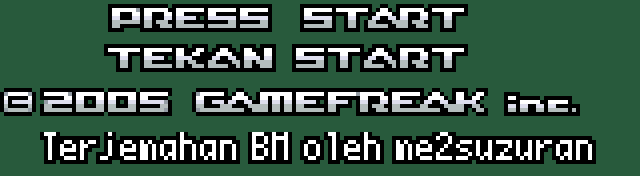

**Ikon jenis dan kategori contest**

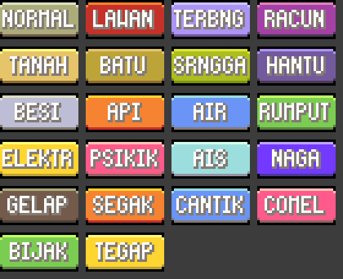

**Skrin ringkasan POKéMON** dan **ikon status** (menu dan pertarungan)

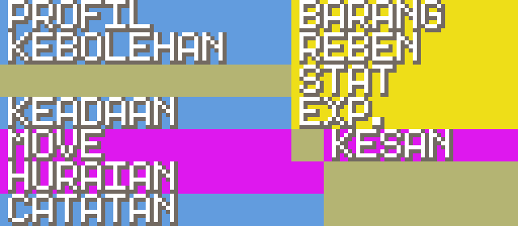

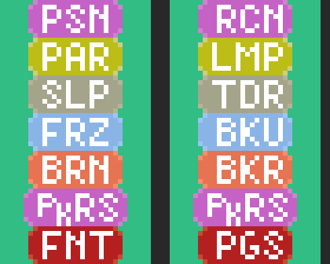 

**Menu move pertarungan:** slot nama dilebarkan ke 80px (nama move sampai 16
huruf) dan jenis move ditunjuk dengan ikon

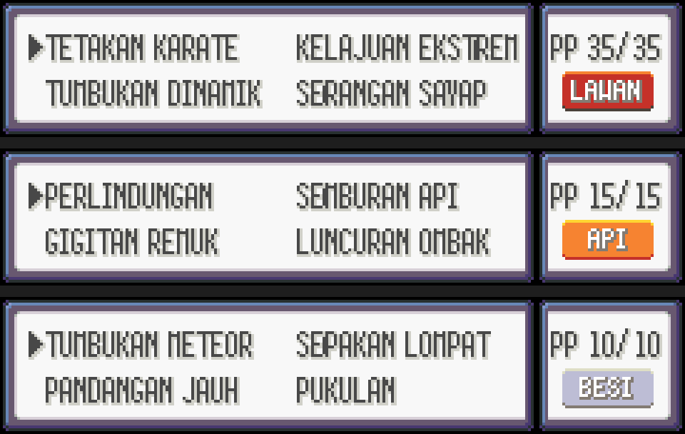

**Pokédex**

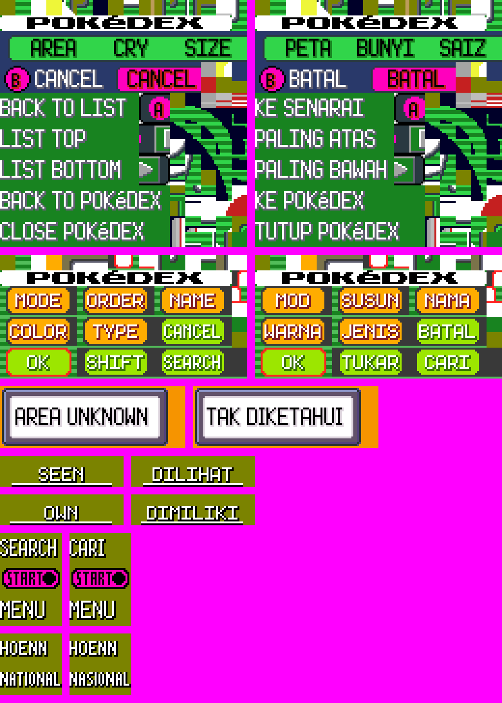

**PokéNav**

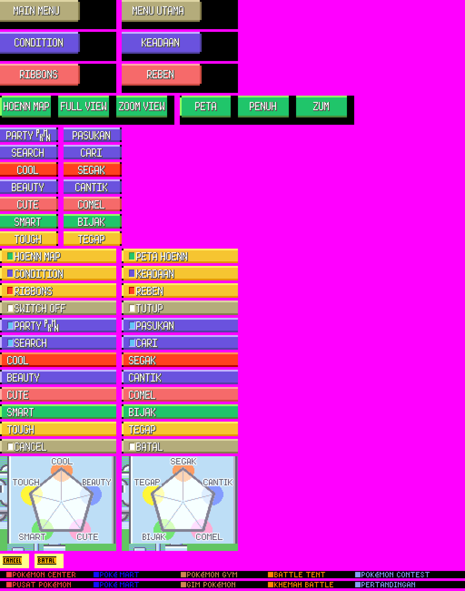

**Kad jurulatih, Frontier Pass, PC, beg, Easy Chat dan lain-lain**

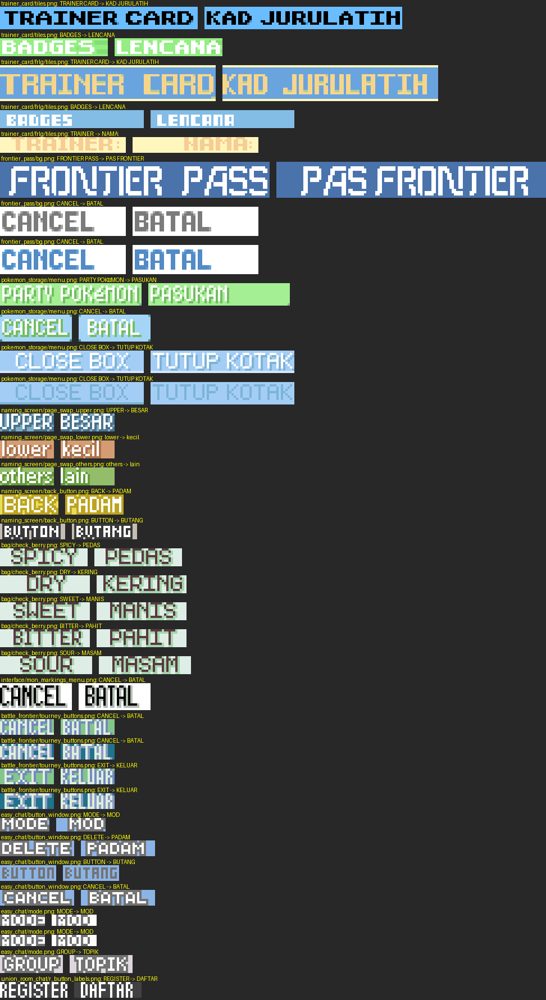

<details>
<summary>Lagi: skrin penuh kad jurulatih, Frontier Pass, PC (5 gambar)</summary>

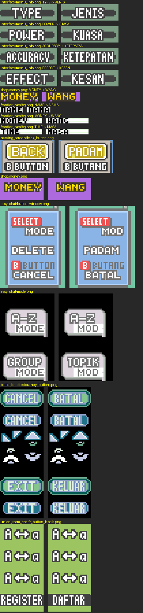
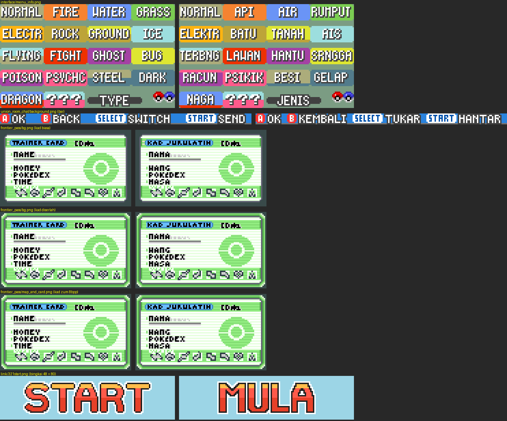
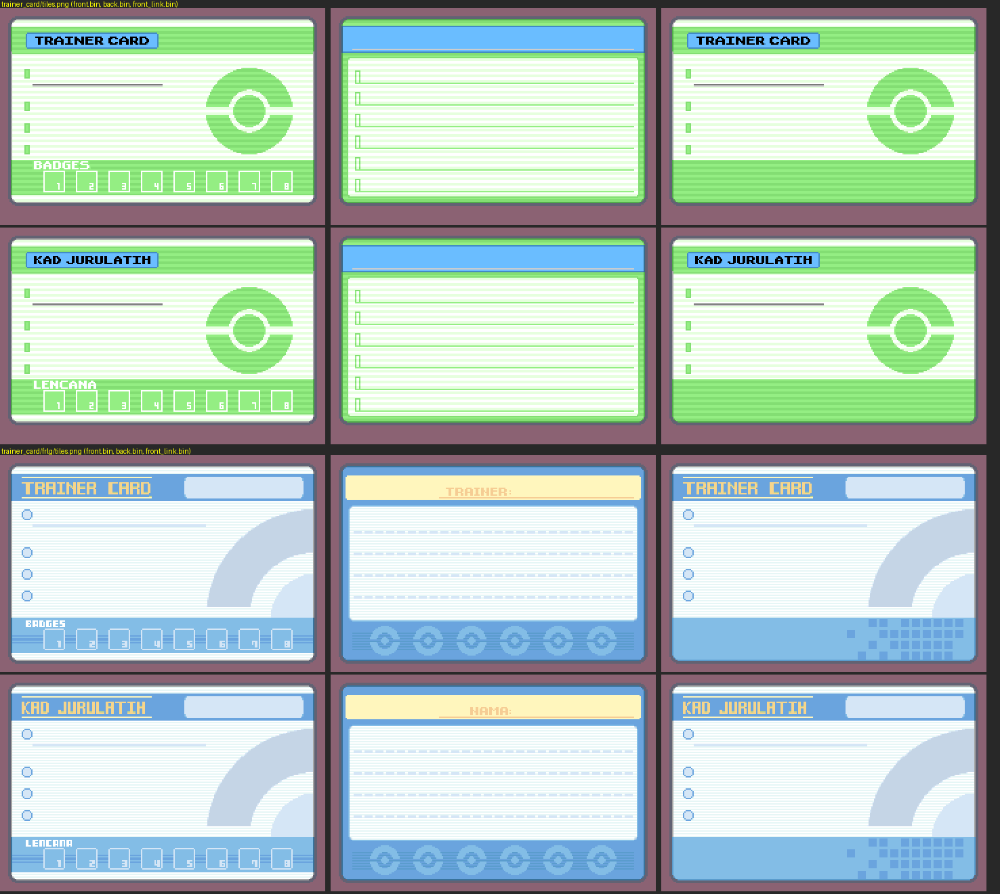
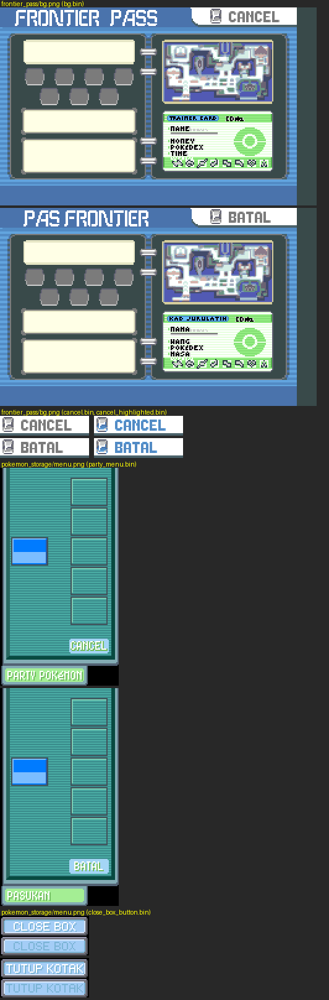
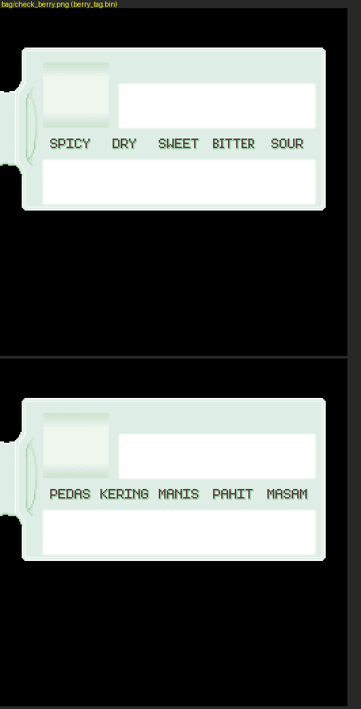

</details>

**Permainan mini, contest, mesin slot, Pokéblock**

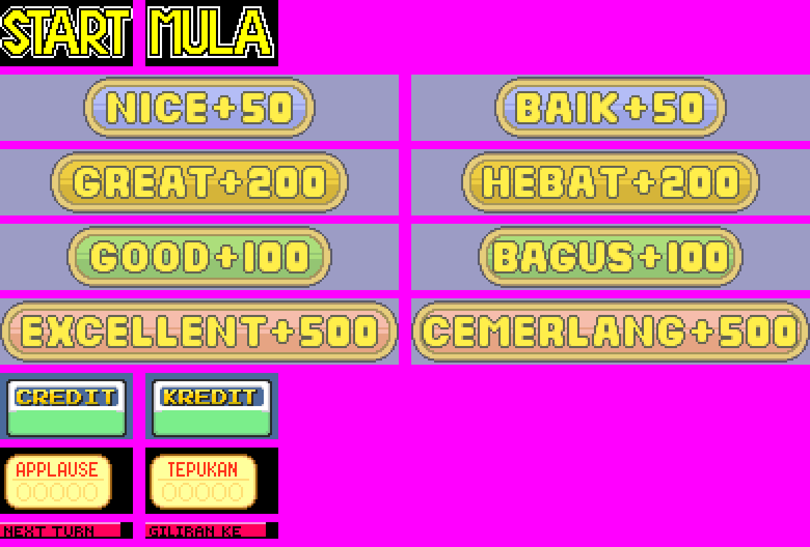

<details>
<summary>Lagi: contest, mesin slot, Pokéblock (4 gambar)</summary>

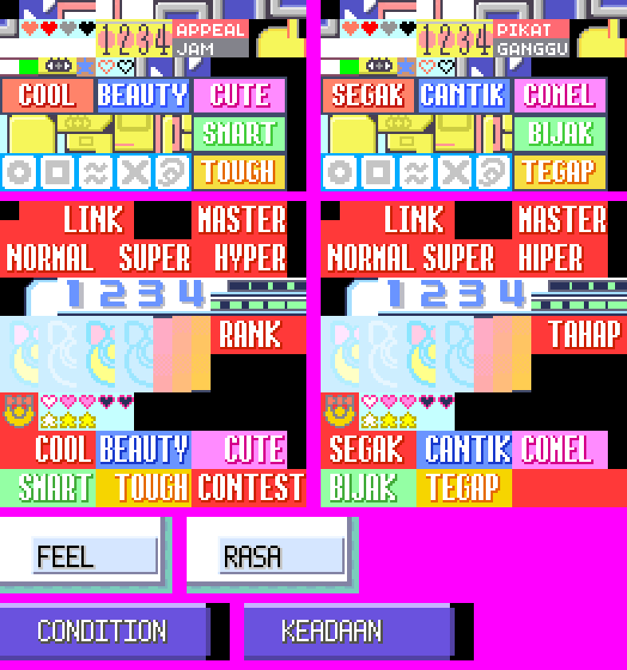
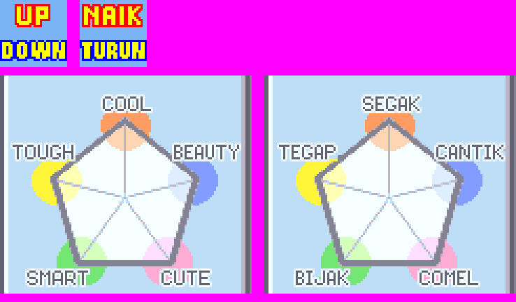
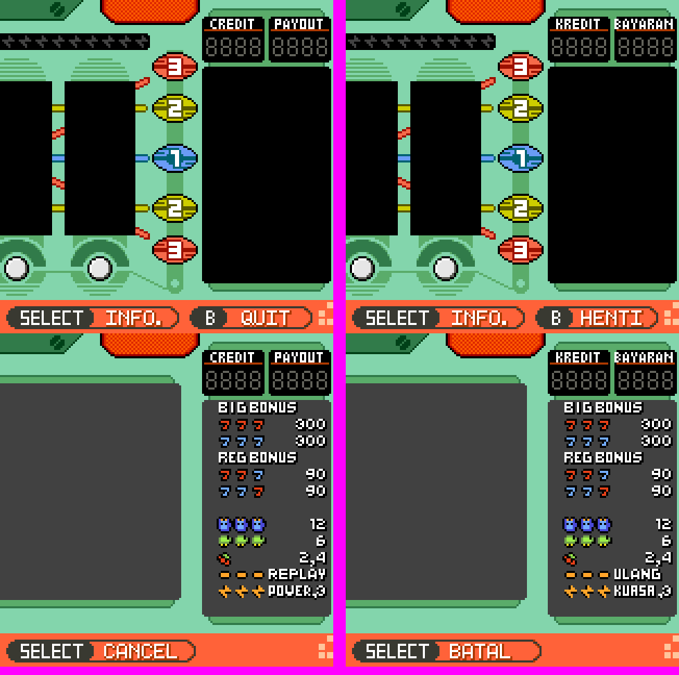
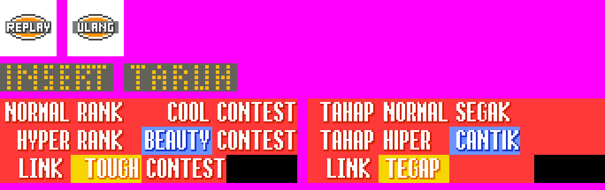

</details>

## Istilah

Istilah dan gaya bahasa: [GLOSARI.md](GLOSARI.md) dan
[SENARAI-NAMA.md](SENARAI-NAMA.md). Status kerja: [PELAN-TERJEMAHAN.md](PELAN-TERJEMAHAN.md).

## Bina ROM

Langkah sama seperti pokeemerald asal (lihat [INSTALL.md](INSTALL.md)). Ringkasnya,
dalam Linux atau WSL (Ubuntu):

```bash
sudo apt install build-essential binutils-arm-none-eabi git libpng-dev
git clone https://github.com/pret/agbcc
cd agbcc && ./build.sh && ./install.sh ../pokeemerald-melayu && cd ..
cd pokeemerald-melayu
make -j$(nproc)
```

Hasilnya `pokeemerald.gba`. Main dengan emulator seperti mGBA.

## Alat semakan (`tools/`)

Semua alat ditulis dalam Python 3 dan membandingkan teks dengan versi Inggeris
asal melalui tag git `asal` (`git tag asal 731ad5b` jika tiada).

| Alat | Fungsi |
|---|---|
| `semak_teks.py` | Lebar piksel setiap baris (font game), had panjang nama, kod kawalan, kotak dialog 2 baris |
| `semak_istilah.py` | Keseragaman istilah dan sisa Bahasa Inggeris |
| `imbas_gaya.py` | Corak bahasa terjemahan literal, bentuk Indonesia, pinjaman Inggeris |
| `cari_baki_inggeris.py` | Label dialog yang masih sama dengan Inggeris |
| `balut_semula.py` | Balut semula baris dialog yang terlalu lebar |
| `cari_dalam_rom.py` | Sahkan teks wujud dalam ROM yang dibina |
| `jana_senarai_nama.py` | Jana SENARAI-NAMA.md |
| `jana_easy_chat_abjad.py` | Jana semula senarai abjad Easy Chat |
| `jana_skrin_tajuk.py` | Jana banner "TEKAN START" dan kredit (perlu Pillow) |
| `terjemah_nama_tempat.py` | Terjemah nama tempat pop-up peta |
| `kata_nama_move.py` | Tukar nama move ke kata nama, ukur lebar, cari dialog berkaitan |
| `jana_menu_move.py` | Susun semula bingkai menu move pertarungan (perlu Pillow) |
| `pratonton_menu_move.py` | Lukis pratonton menu move pertarungan (perlu Pillow) |

Contoh: `python tools/semak_teks.py data/maps/LittlerootTown/scripts.inc`

## Laporan masalah

Jumpa teks yang terpotong, salah atau janggal? Buka *issue* dengan screenshot dan
lokasi dalam game.

## Kredit

- Dekompilasi: [pret](https://pret.github.io/) — README asal di [README-pret.md](README-pret.md)
- Terjemahan Bahasa Melayu: me2suzuran
